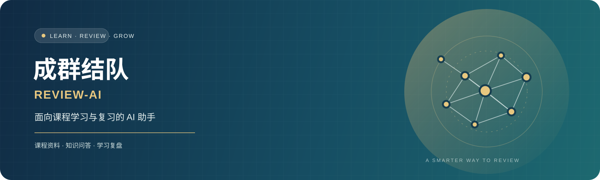
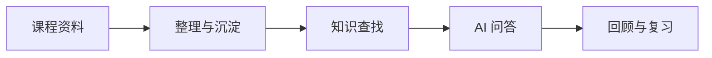

<div align="center">
  
  <br />
  <br />
  <strong>课程资料 × 知识问答 × AI 复习助手</strong>
  <br />
  为课程学习整理思路，让知识查找与复习更顺畅。
  <br />
  <br />
  <a href="#产品概览">产品概览</a> ·
  <a href="#原型体验">原型体验</a> ·
  <a href="#设计文档">设计文档</a> ·
  <a href="#仓库导航">仓库导航</a>
</div>

---

## 产品概览

**Review-AI** 面向大学生课程复习场景，围绕课程资料整理、知识查找与智能问答，探索大语言模型与课程知识库结合的学习体验。

本仓库集中整理系统与数据库设计说明书、UML / ER 图、交互原型 PDF，以及静态页面原型，方便快速了解项目方案与界面流程。

### 学习体验



### 原型页面

| 学生端 | 管理端 |
|---|---|
| 首页与工作台<br>课程问答与回答结果<br>历史记录与响应式页面 | 登录与智能体配置<br>模板与记录管理<br>运行监控 |

## 原型体验

### 墨刀在线原型

> 若从 GitHub 点击后显示 410，请复制完整地址，在新标签页或浏览器地址栏中单独打开。

`https://modao.cc/proto/Ydph54cjtowmfgY2SDAjvm/sharing?view_mode=read_only`

### 静态交互原型

> 若遇到 410，请复制完整地址后单独打开。

`https://pb-ytfvupsvdd2eyizlqbbazbqzcaj34oo2vy33saa.ai.modao.ink/index.html`

## 设计文档

| 文档 | 内容 |
|---|---|
| [系统设计说明书 PDF](https://github.com/zhenglebing/cheng-qun-jie-dui/raw/refs/heads/main/docs/%E7%B3%BB%E7%BB%9F%E8%AE%BE%E8%AE%A1%E8%AF%B4%E6%98%8E%E4%B9%A6.pdf) | 系统方案与功能设计 |
| [数据库设计说明书 PDF](https://github.com/zhenglebing/cheng-qun-jie-dui/raw/refs/heads/main/docs/%E6%95%B0%E6%8D%AE%E5%BA%93%E8%AE%BE%E8%AE%A1%E8%AF%B4%E6%98%8E%E4%B9%A6.pdf) | 数据模型与数据库设计 |
| [UML / ER 图源文件与预览](docs/uml/) | 用例、活动、时序、协作、类图与 ER 图 |
| [原型 PDF 备份](prototype/) | Review-AI 复习助手交互原型 |

## 仓库导航

```text
.
├── README.md
├── docs/
│   ├── assets/              # README 横幅
│   ├── uml/                 # UML / ER 源文件与渲染图
│   ├── 系统设计说明书.pdf
│   └── 数据库设计说明书.pdf
├── prototype/               # 原型 PDF 备份
└── web/                     # 静态交互原型页面与资源
```

---

<div align="center">
  <sub>成群结队 · Review-AI</sub><br />
  <sub>把课程知识整理好，让每一次复习更有方向。</sub>
</div>
